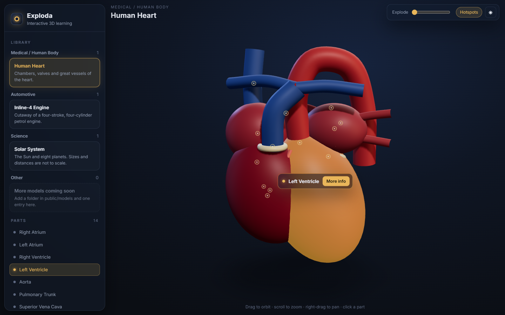
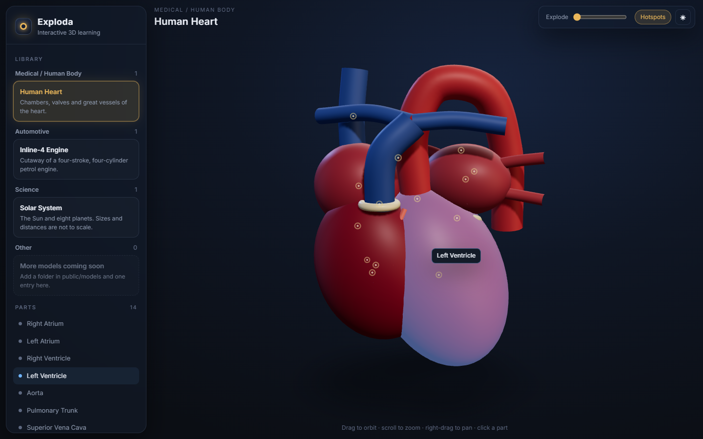
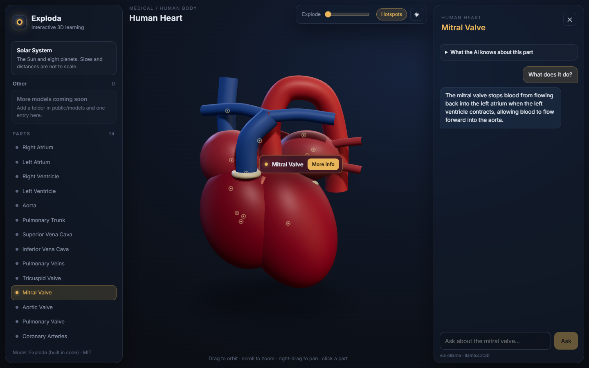
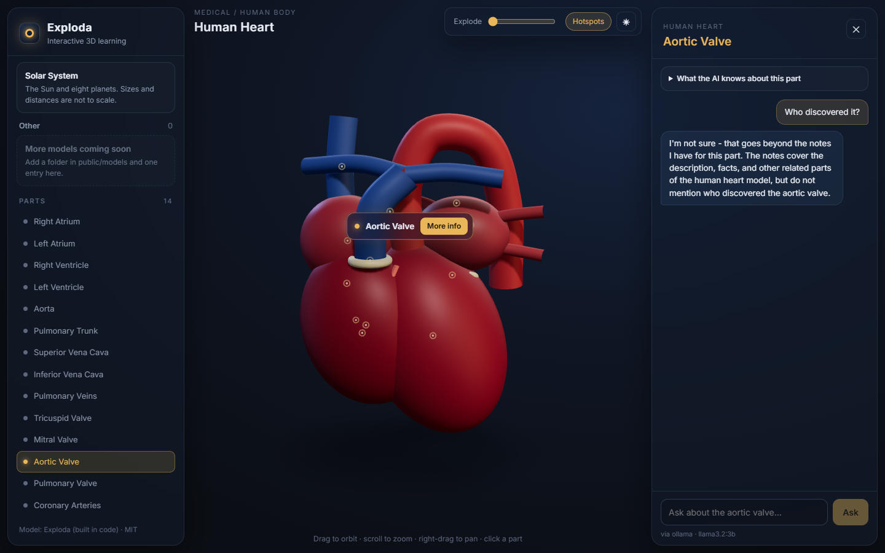
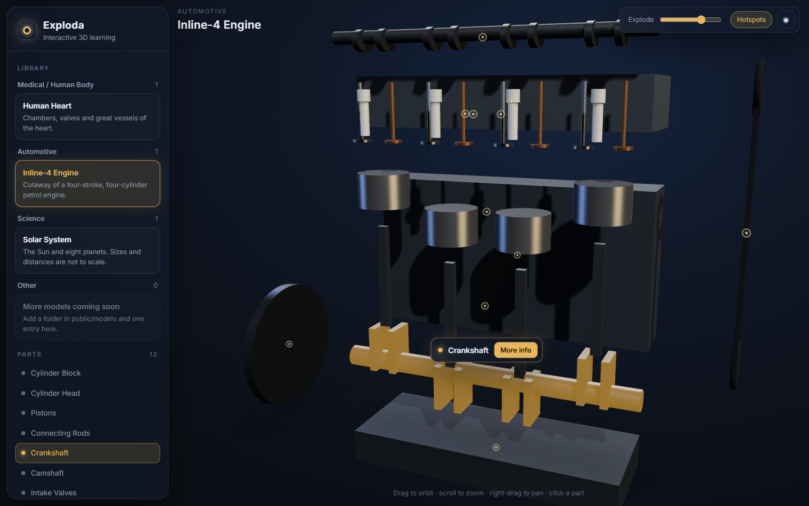
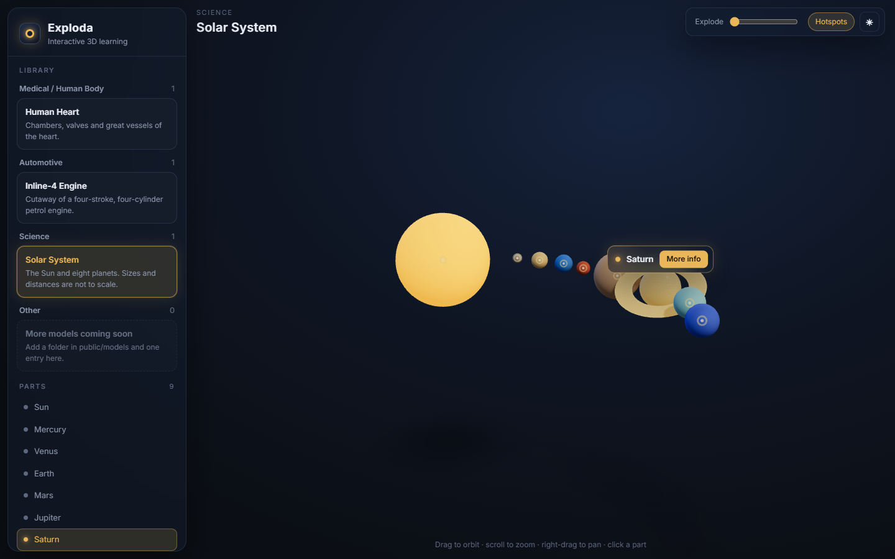
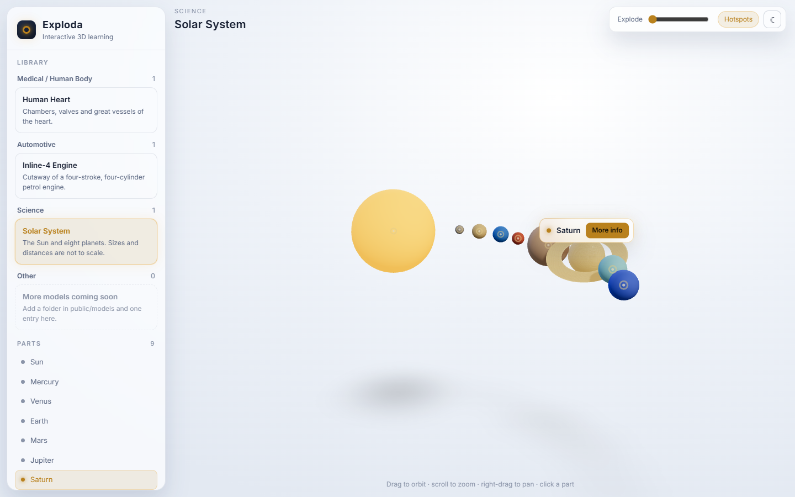
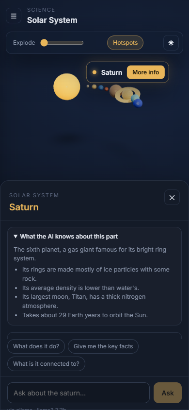
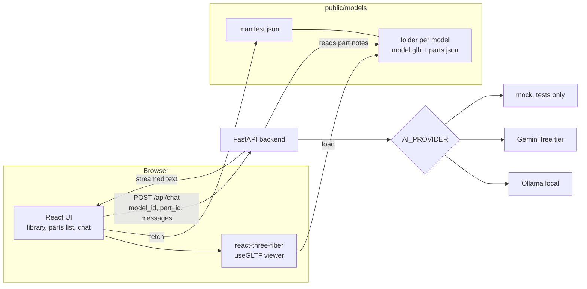

# Exploda

An interactive 3D learning app. Pick a model from the library, click any part to highlight it, then hit **More info** to open an AI chat that answers questions about that part, using only the facts stored for it.



## What it does

- **Library by category**: Medical / Human Body, Automotive, Science, Other. Models come from a manifest file, so nothing is hardcoded in the UI.
- **3D stage**: orbit, zoom and pan; soft studio lighting and contact shadows.
- **Part picking**: hover a part to see a blue highlight and its name, click it to keep it highlighted in gold with a name label and a **More info** button. Faint hotspot dots mark every interactive part, and a parts list in the sidebar does the same job.
- **Explode slider**: pulls the parts apart so hidden ones (like heart valves) are easier to reach.
- **Grounded AI chat**: a side panel titled with the part name. Answers stream in, and every part keeps its own thread. The model only gets that part's notes and is told to say "I'm not sure" when a question goes beyond them.
- **Free AI providers**: local Ollama or the Gemini free tier, picked in `backend/.env`. With neither configured the panel says **AI not configured** and never makes up an answer.
- Dark and light mode, and a mobile layout (library drawer + chat bottom sheet).

| Hover | Grounded chat | "I'm not sure" |
|---|---|---|
|  |  |  |

| Engine, exploded | Solar system | Light mode | Mobile |
|---|---|---|---|
|  |  |  |  |

## How it fits together



The browser never sends facts or keys. It sends the model id, part id and the chat so far; the backend looks the part up in the same `parts.json` the viewer uses and builds the prompt itself.

## Run it

Needs Node 18+ and Python 3.11.

```bash
# 1. backend (AI calls only)
cd backend
python -m venv .venv
.venv\Scripts\activate            # macOS/Linux: source .venv/bin/activate
pip install -r requirements.txt
cp .env.example .env              # pick ollama or gemini inside
uvicorn app:app --port 8000

# 2. frontend (new terminal)
cd frontend
npm install
npm run dev                        # http://localhost:5173
```

**AI setup** (`backend/.env`):

- Ollama: install it, run `ollama pull llama3.2:3b` (about 2 GB), keep `AI_PROVIDER=ollama`.
- Gemini: get a free key at https://aistudio.google.com/apikey, set `AI_PROVIDER=gemini` and `GEMINI_API_KEY=...`.
- Leave `AI_PROVIDER` empty to see the "AI not configured" state.

Optional single-process mode: `npm run build` in `frontend/`, then `uvicorn app:app` serves the built site too, at http://localhost:8000.

## Self-test

```bash
cd backend
.venv\Scripts\python selftest.py
```

No key or network needed. Output from the last run:

```
PASS  category manifest loads: 4 categories, 3 models
PASS  parts data maps to meshes: heart 14/14, engine 12/12, solar-system 9/9
PASS  AI backend via mock provider: streamed grounded answer, unknown part -> 404
PASS  no provider -> not configured: no provider -> 503 'AI not configured'

4/4 passed
```

It checks that every part in each `parts.json` has a mesh with the same name in the `.glb` (and the other way round), that every model file is under 5 MB, and that the chat endpoint streams a grounded answer through the mock provider.

## Adding a model

1. Make a folder: `frontend/public/models/<id>/` with `model.glb` and `parts.json`.
2. In the GLB, give every clickable mesh a name. In `parts.json`, add one entry per mesh name:
   ```json
   { "left_ventricle": { "name": "Left Ventricle", "description": "...", "facts": ["...", "..."] } }
   ```
3. Add an entry to a category in `frontend/public/models/manifest.json` (id, name, folder, file, parts, description, credit).
4. Run the self-test to confirm parts and meshes line up.

No code changes are needed; the library, viewer, parts list and chat all read from these files.

## Models and licenses

| Model | Category | Source | License |
|---|---|---|---|
| Human Heart (14 parts) | Medical / Human Body | Built in code for this project (`frontend/scripts/build-models.mjs`) | MIT |
| Inline-4 Engine (12 parts) | Automotive | Built in code for this project | MIT |
| Solar System (9 parts) | Science | Built in code for this project | MIT |

I couldn't find free CC0/CC-BY models of these subjects with cleanly separated, named meshes, so all three are simplified models built from three.js shapes and exported to GLB by `npm run models`. No third-party 3D assets are used. If a CC-BY model is added later, its author and license go in its manifest `credit` field, which the sidebar shows under the parts list.

## Tech

React 18 + Vite (JavaScript), three.js through @react-three/fiber and @react-three/drei, plain CSS. FastAPI + httpx for the backend; providers share one small interface (`status()` and `stream()`).

## Limitations

- The models are simplified teaching shapes, not anatomically or mechanically accurate. The heart valves sit mostly inside the chambers; use the explode slider to reach them.
- Grounding limits what the model is told, but a small local model can still word things wrongly. In one test llama3.2:3b said the mitral valve lets blood "flow forward into the aorta" (it opens into the left ventricle). A larger model or Gemini follows the notes more closely.
- Part notes are short and hand-written; the chat can only be as good as they are.
- Threads live in memory and reset on page reload.
- Only tested in Edge/Chromium on Windows.

## License

MIT
