# Exploda

An interactive 3D learning app. Pick a model from the library, click any part to highlight it, then hit **More info** to open an AI chat that answers questions about that part, using only the facts stored for it.

The models are real: human anatomy from the BodyParts3D database (built from medical imaging data), a detailed concept car and chronograph watch from the Khronos glTF sample assets, and a solar system with real planet texture maps.

**Live demo:** https://omkar210404.github.io/exploda/ (3D viewer, labels and quiz work; the AI chat needs the local backend, so it is switched off there)

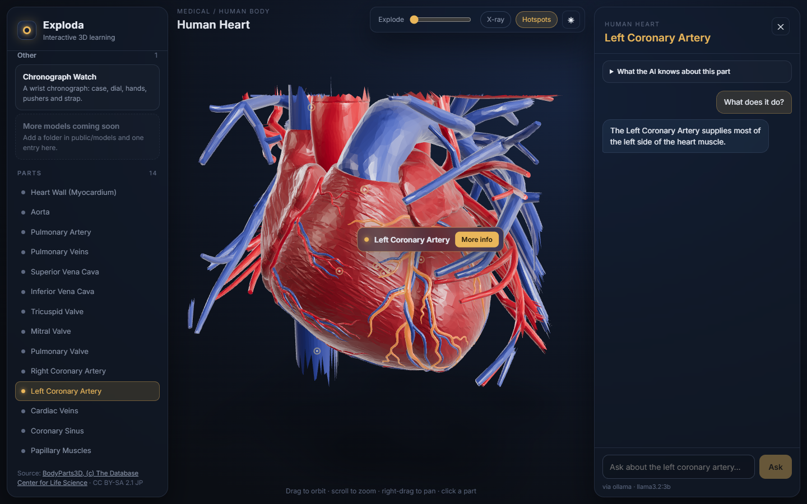

## What it does

- **Library by category**: Medical / Human Body (heart, skull, lungs, brain, abdominal organs, skeleton), Automotive (concept car), Science (solar system), Other (chronograph watch). Models come from a manifest file, so nothing is hardcoded in the UI.
- **3D stage**: orbit, zoom and pan; studio HDRI lighting with contact shadows, or a starfield for the solar system.
- **Part picking**: hover a part to see a blue highlight and its name, click it to keep it highlighted in gold with a name label and a **More info** button. Faint hotspot dots mark every interactive part, and a parts list in the sidebar does the same job.
- **Camera fly-to**: selecting a part smoothly frames it (with some of the model around it for context); deselecting goes back to the whole model.
- **Labels**: shows every part's name at once, like a textbook diagram. Click a label to select that part.
- **Quiz**: "Find the mitral valve". Ten random parts per round, names hidden, the right answer shown in gold after each try, and a score at the end.
- **Explode slider**: pulls the parts apart.
- **X-ray**: makes the outer parts (heart wall, car body, watch crystal) see-through and click-through, so you can pick what is inside: heart valves and papillary muscles, the car's seats, steering and engine.
- **Grounded AI chat**: a side panel titled with the part name. Answers stream in, and every part keeps its own thread, saved in the browser so it survives a reload (with a Clear button). The model only gets that part's notes and is told to say "I'm not sure" when a question goes beyond them.
- **Answer style**: Simple (for a 12-year-old), Normal or Technical. The style changes the wording only; the facts still come from the same notes.
- **Free AI providers**: local Ollama or the Gemini free tier, picked in `backend/.env`. With neither configured the panel says **AI not configured** and never makes up an answer.
- Dark and light mode, and a mobile layout (library drawer + chat bottom sheet).

| Heart, hover | Heart, X-ray | Skull | Lungs |
|---|---|---|---|
| 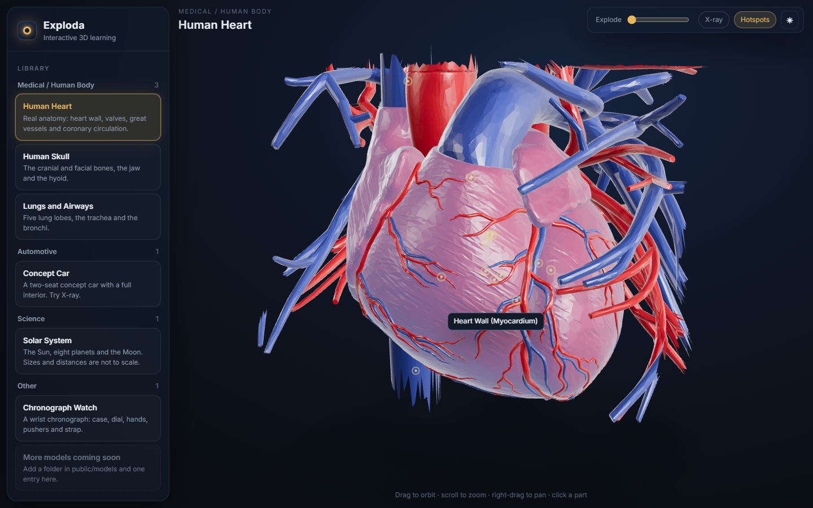 | 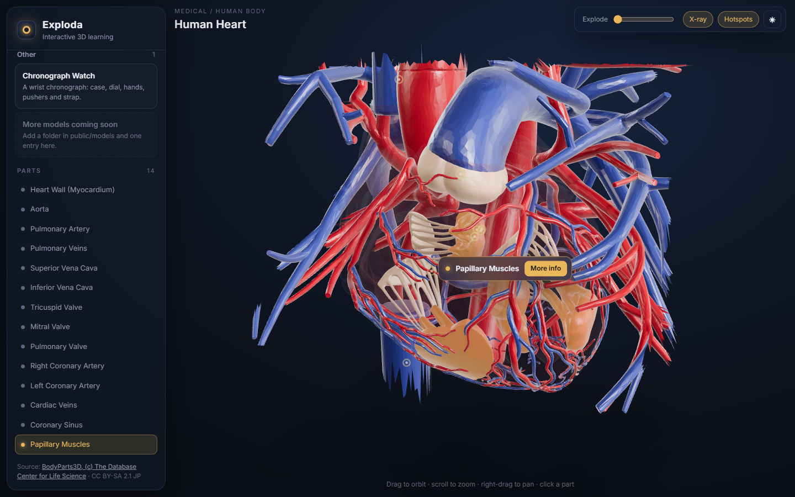 | 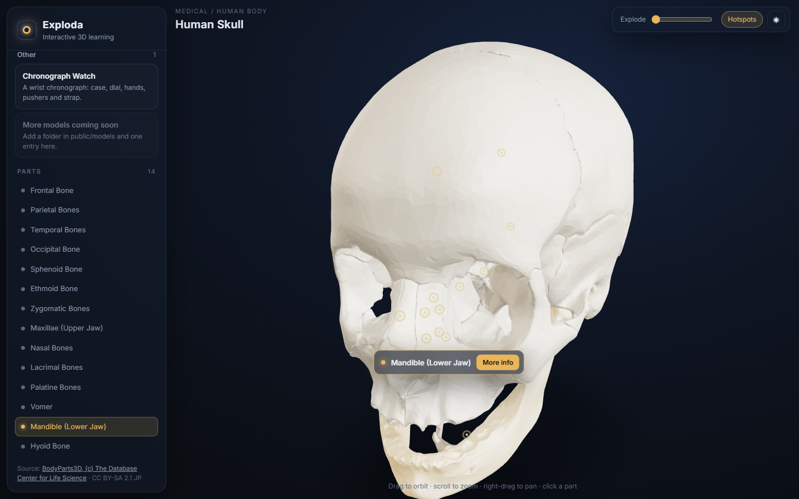 | 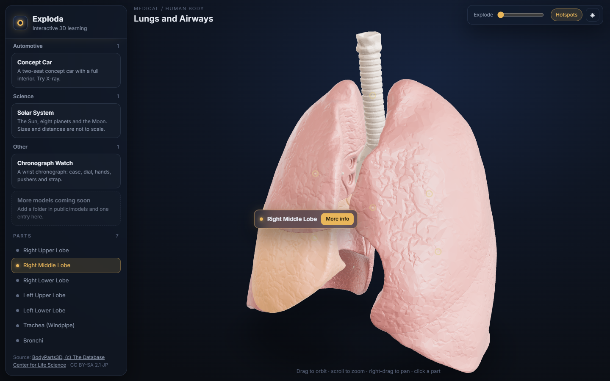 |

| Brain, labels | Brain, X-ray + Simple chat | Skeleton | Skeleton, fly-to |
|---|---|---|---|
| 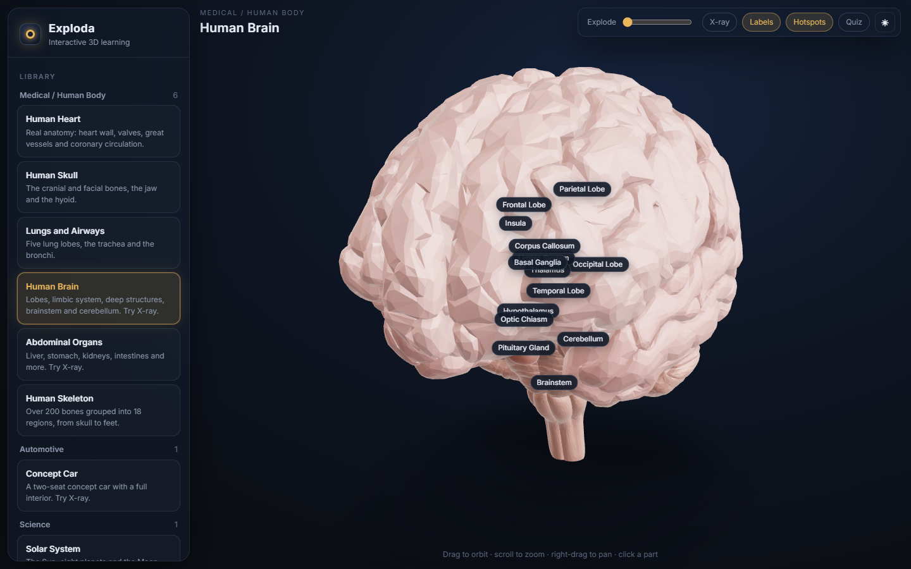 | 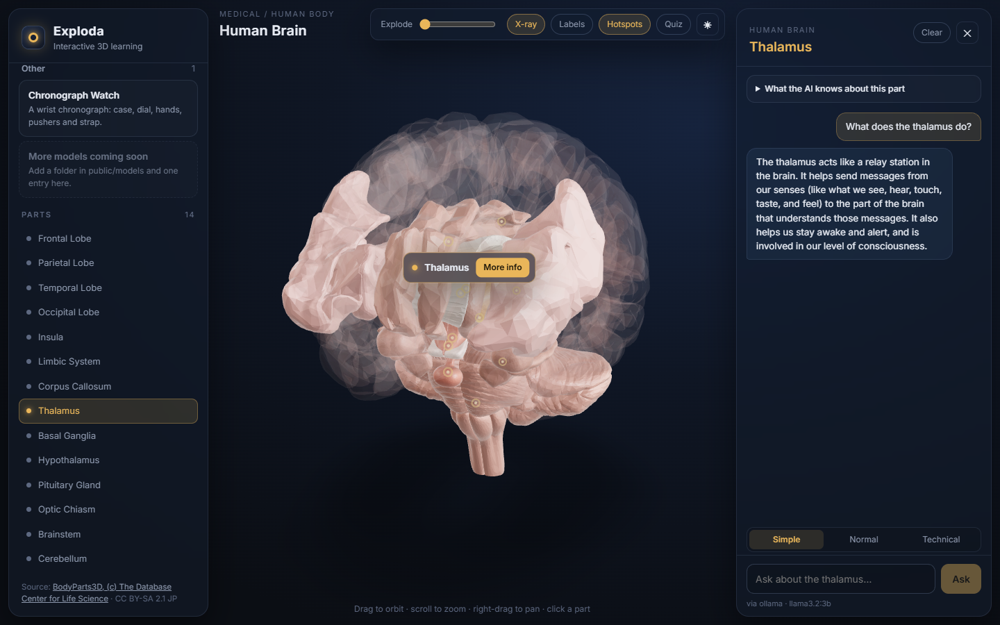 | 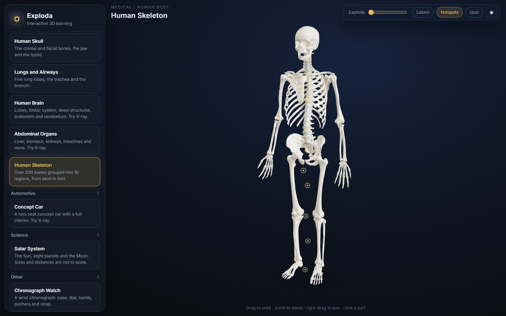 | 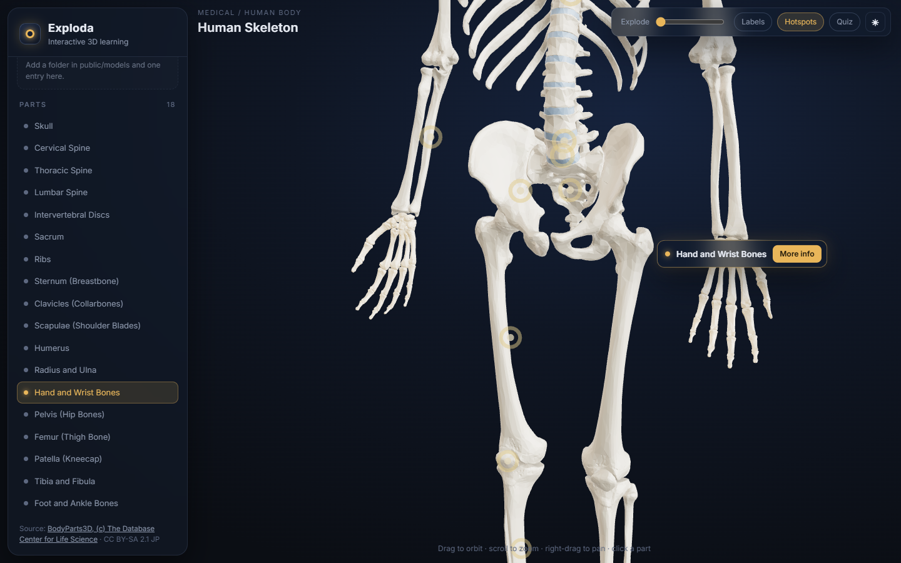 |

| Abdomen, X-ray | Quiz | Concept car, X-ray | Solar system | Chronograph watch |
|---|---|---|---|---|
| 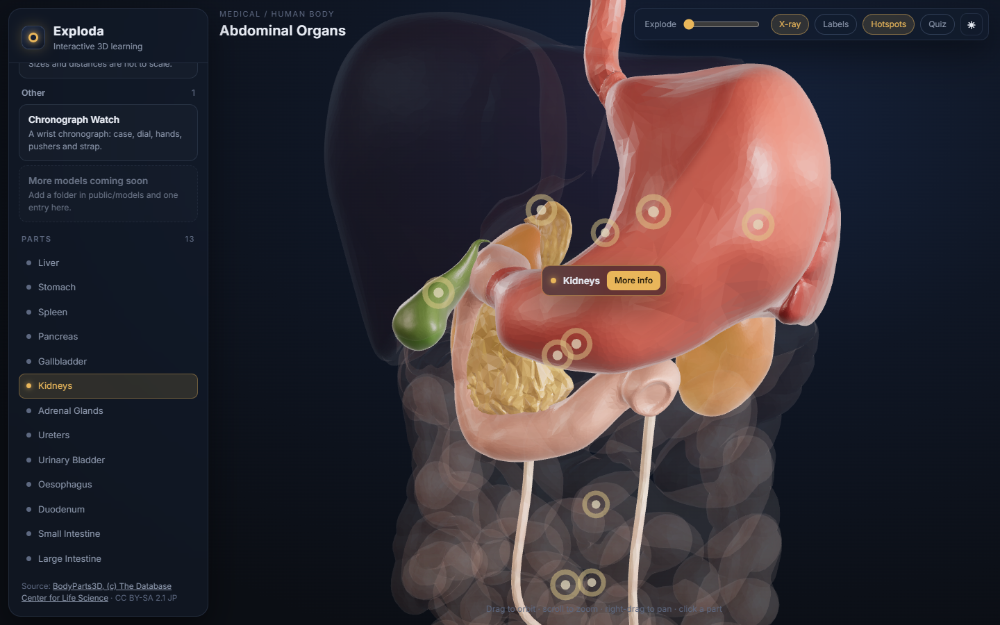 | 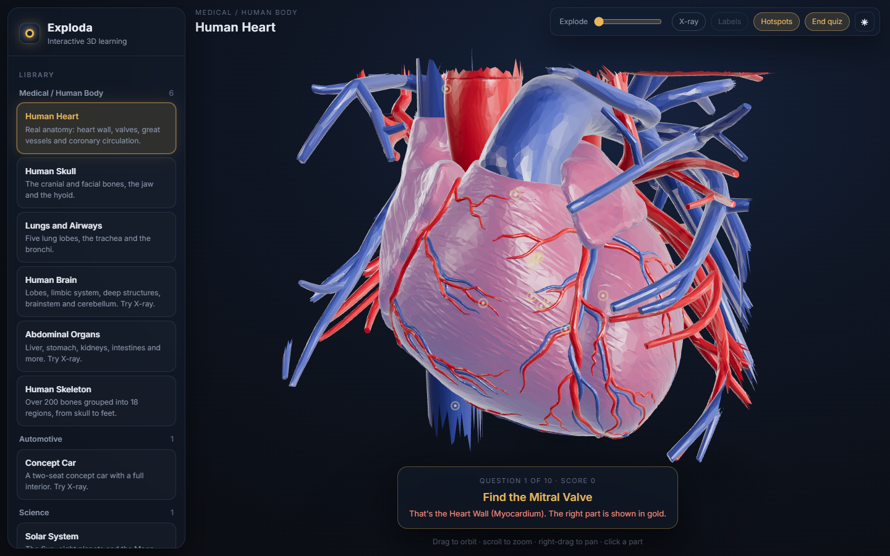 | 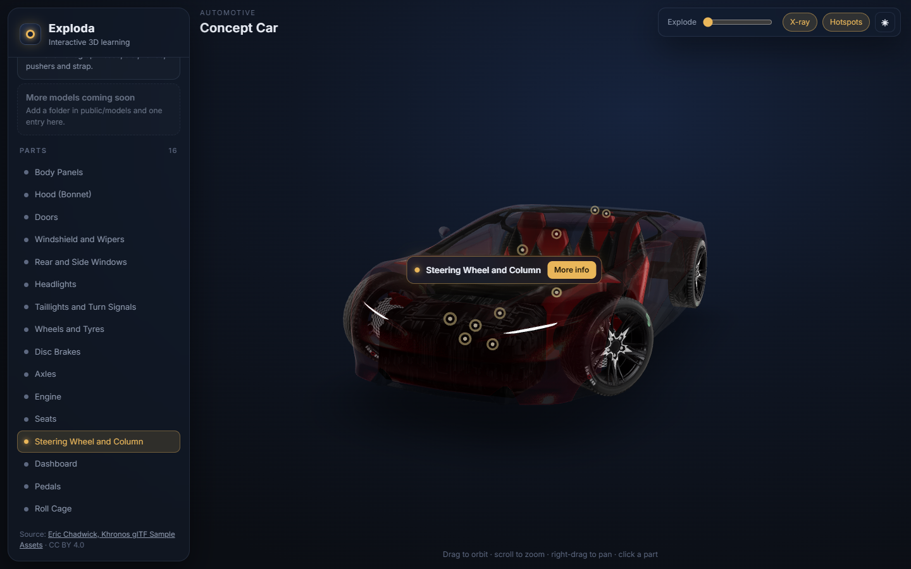 | 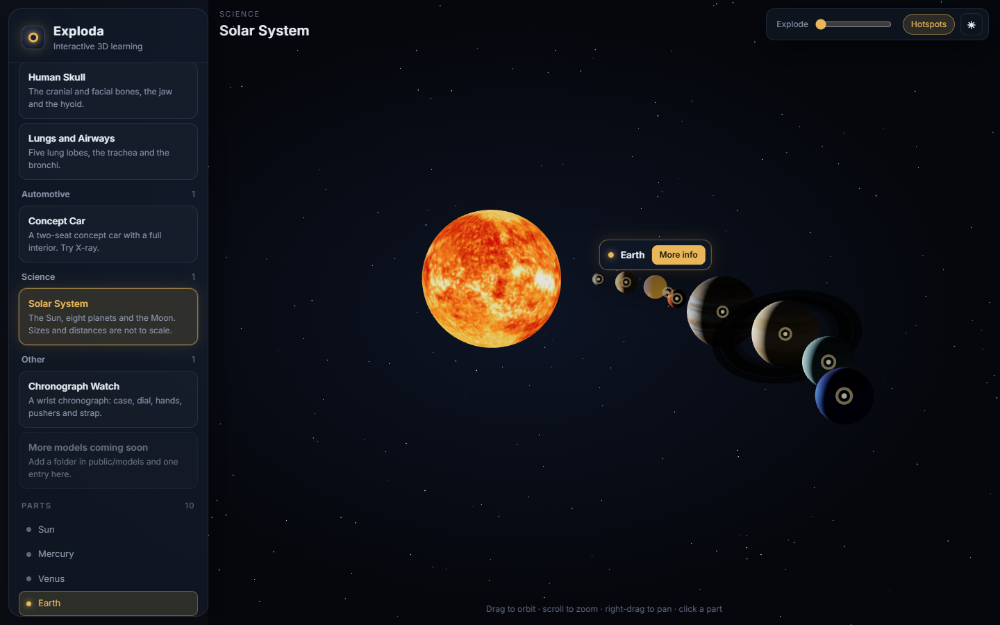 | 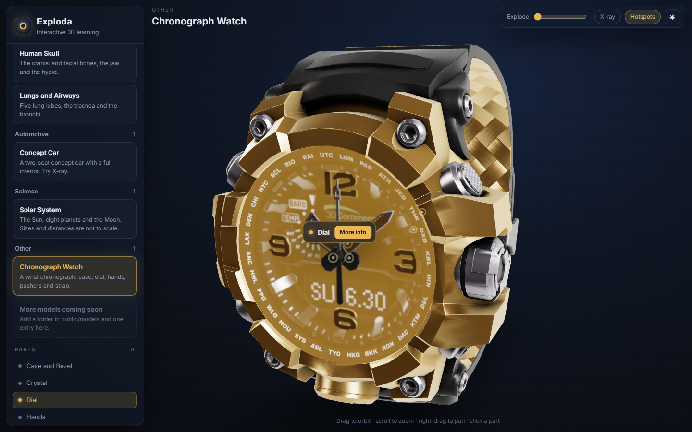 |

## How it fits together

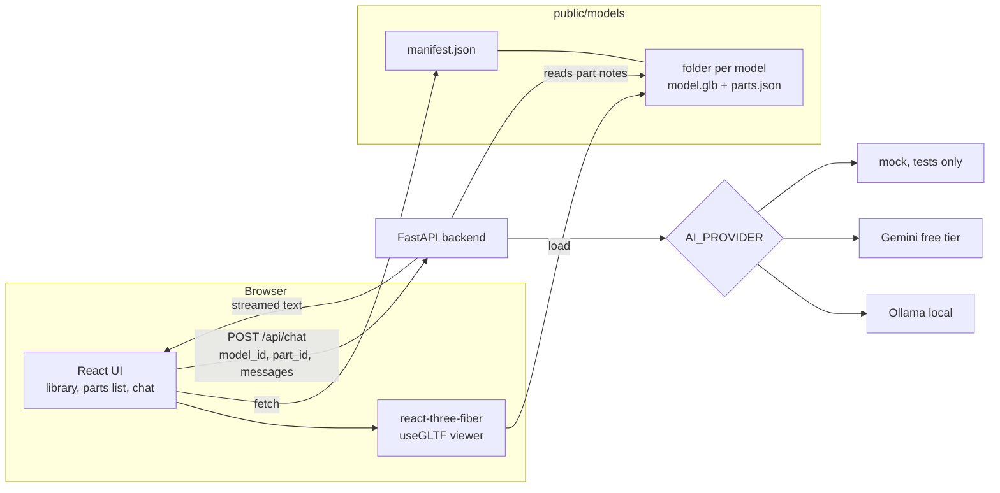

The browser never sends facts or keys. It sends the model id, part id and the chat so far; the backend looks the part up in the same `parts.json` the viewer uses and builds the prompt itself.

## Run it

Needs Node 18+ and Python 3.11.

```bash
# 1. backend (AI calls only)
cd backend
python -m venv .venv
.venv\Scripts\activate            # macOS/Linux: source .venv/bin/activate
pip install -r requirements.txt
cp .env.example .env              # pick ollama or gemini inside
uvicorn app:app --port 8000

# 2. frontend (new terminal)
cd frontend
npm install
npm run dev                        # http://localhost:5173
```

**AI setup** (`backend/.env`):

- Ollama: install it, run `ollama pull llama3.2:3b` (about 2 GB), keep `AI_PROVIDER=ollama`.
- Gemini: get a free key at https://aistudio.google.com/apikey, set `AI_PROVIDER=gemini` and `GEMINI_API_KEY=...`.
- Leave `AI_PROVIDER` empty to see the "AI not configured" state.

Optional single-process mode: `npm run build` in `frontend/`, then `uvicorn app:app` serves the built site too, at http://localhost:8000.

The GitHub Pages demo is a static build: `EXPLODA_BASE=/exploda/ VITE_DEMO=1 npm run build` (in Git Bash, prefix `MSYS_NO_PATHCONV=1` so the path is not rewritten), then the `dist/` folder is pushed to the `gh-pages` branch.

## Self-test

```bash
cd backend
.venv\Scripts\python selftest.py
```

No key or network needed. Output from the last run:

```
PASS  category manifest loads: 4 categories, 9 models
PASS  parts data maps to meshes: heart 14 parts (28/28 meshes), skull 14 parts (21/21 meshes), lungs 7 parts (7/7 meshes), brain 14 parts (57/57 meshes), abdomen 13 parts (19/19 meshes), skeleton 18 parts (224/224 meshes), concept-car 16 parts (97/97 meshes), solar-system 10 parts (11/11 meshes), chronograph-watch 8 parts (13/13 meshes)
PASS  AI backend via mock provider: streamed grounded answer, answer styles, unknown part -> 404
PASS  no provider -> not configured: no provider -> 503 'AI not configured'

4/4 passed
```

It checks that every part in each `parts.json` matches at least one mesh in its `.glb` (using the same matching rule as the viewer), that every model file is under 5 MB, and that the chat endpoint streams a grounded answer through the mock provider.

## Adding a model

1. Make a folder: `frontend/public/models/<id>/` with `model.glb` and `parts.json`.
2. In `parts.json`, add one entry per part. By default a part matches the mesh with the same name; use `meshes` (names or `*` globs) to group several meshes into one part, and `shell: true` for outer parts that X-ray should make see-through:
   ```json
   {
     "mitral_valve": { "name": "Mitral Valve", "description": "...", "facts": ["...", "..."] },
     "doors": { "name": "Doors", "shell": true, "meshes": ["BodyDoorL*", "BodyDoorR*"], "description": "...", "facts": ["..."] }
   }
   ```
3. Add an entry to a category in `frontend/public/models/manifest.json` (id, name, folder, file, parts, description, credit).
4. Run the self-test to confirm parts and meshes line up.

No code changes are needed; the library, viewer, parts list and chat all read from these files.

## Models and licenses

| Model | Parts | Size | Source | License |
|---|---|---|---|---|
| Human Heart | 14 (28 meshes) | 4.8 MB | [BodyParts3D](https://dbarchive.biosciencedbc.jp/en/bodyparts3d/lic.html), via the [STL mirror](https://github.com/Kevin-Mattheus-Moerman/BodyParts3D) | CC BY-SA 2.1 JP |
| Human Skull | 14 (21 meshes) | 4.3 MB | BodyParts3D | CC BY-SA 2.1 JP |
| Lungs and Airways | 7 | 4.3 MB | BodyParts3D | CC BY-SA 2.1 JP |
| Human Brain | 14 (57 meshes) | 4.9 MB | BodyParts3D | CC BY-SA 2.1 JP |
| Abdominal Organs | 13 (19 meshes) | 4.4 MB | BodyParts3D | CC BY-SA 2.1 JP |
| Human Skeleton | 18 (224 meshes) | 4.5 MB | BodyParts3D | CC BY-SA 2.1 JP |
| Concept Car | 16 (97 meshes) | 3.2 MB | [CarConcept](https://github.com/KhronosGroup/glTF-Sample-Assets/tree/main/Models/CarConcept) by Eric Chadwick, Khronos glTF Sample Assets | CC BY 4.0 |
| Chronograph Watch | 8 (13 meshes) | 1.9 MB | [ChronographWatch](https://github.com/KhronosGroup/glTF-Sample-Assets/tree/main/Models/ChronographWatch) by Eric Chadwick, Khronos glTF Sample Assets | CC BY 4.0 |
| Solar System | 10 | 0.6 MB | Spheres built in code; textures from [Solar System Scope](https://www.solarsystemscope.com/textures/) | Textures CC BY 4.0 |
| Studio lighting | - | 1.6 MB | [Studio Small 09](https://polyhaven.com/a/studio_small_09), Poly Haven | CC0 |

Attribution as BodyParts3D asks: "BodyParts3D, (c) The Database Center for Life Science licensed under CC Attribution-Share Alike 2.1 Japan". The anatomy `.glb` files are adapted from it (converted, trimmed around the organ, simplified), so they stay under CC BY-SA 2.1 JP. The Khronos models carry Khronos logos (trademarks, not covered by CC BY) and the watch clasp has a "DGG" logo. Each model's source and license also shows in the app under its parts list.

`npm run models` (in `frontend/`) rebuilds every model (`npm run models -- brain,skeleton` rebuilds only those): it downloads the sources into `scripts/.cache/` (ignored by git), names each part, reduces polygon counts with meshoptimizer, converts textures to 1024 px WebP and writes meshopt-compressed `.glb` files.

## Tech

React 18 + Vite (JavaScript), three.js through @react-three/fiber and @react-three/drei, plain CSS. Model pipeline: glTF-Transform, meshoptimizer and sharp (dev dependencies only). FastAPI + httpx for the backend; providers share one small interface (`status()` and `stream()`).

## Limitations

- In BodyParts3D the four heart chambers are one mesh (the heart wall), so the atria and ventricles can't be picked separately; X-ray shows the valves and papillary muscles inside. The aortic valve has no mesh in this version of the dataset.
- The anatomy meshes were simplified to stay under 5 MB, so close up you can see some faceting. Long vessels are cut off a little past the heart.
- The concept car's engine is a simple block in the source model, so engine questions mostly get "I'm not sure".
- The brain cortex in BodyParts3D 3.0 has gaps (for example there is no inferior frontal gyrus mesh), and the skeleton has no coccyx.
- Bones and brain regions were simplified hard to fit 200+ meshes under 5 MB, so they look smoother and blockier than the source scans.
- Paired parts (both kidneys, both hands) are one part, so the fly-to frames both sides.
- Grounding limits what the model is told, but a small local model can still word things wrongly. In an earlier test llama3.2:3b said the mitral valve lets blood "flow forward into the aorta" (it opens into the left ventricle). A larger model or Gemini follows the notes more closely.
- Part notes are short and hand-written; the chat can only be as good as they are.
- Saved chats live only in this browser (localStorage); they are not synced anywhere.
- Only tested in Edge/Chromium on Windows.

## License

Code: MIT. Model and texture files keep the licenses listed above.
